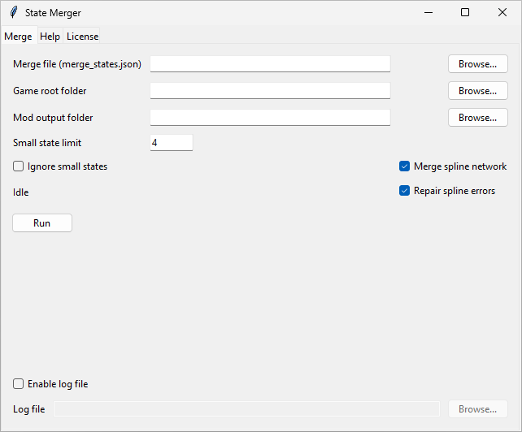
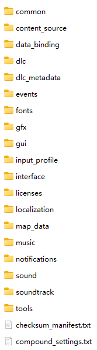
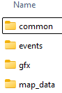

# Victoria 3 States Merging Automation Script & Tutorial


[](https://app.codacy.com/gh/ShabbyGayBar/StateMerger/dashboard?utm_source=gh&utm_medium=referral&utm_content=&utm_campaign=Badge_grade)

[简体中文](docs/README_zh-CN.md)

Check out my [State Merging Mod](https://github.com/ShabbyGayBar/StateMerging) generated by this script! Available on [Steam Workshop](https://steamcommunity.com/sharedfiles/filedetails/?id=3371693463)!

## Description

This repository contains a Python project that automates the process of merging states in Victoria 3.

It generates the following files that can be used in a Victoria 3 mod:
- `/common/...`
- `/event/...`
- `/map_data/state_regions/...`

## How to Make Your Own State Merging Mod

### Step 0: Prerequisites

- **Either:**
  - Download the latest GUI executable file from the [release page](https://github.com/ShabbyGayBar/StateMerger/releases). (Recommended but Windows only)
  - **Or:**
  - Install [Python 3.14 or later](https://www.python.org/downloads/).
  - Run
    `pip install "https://github.com/ShabbyGayBar/StateMerger/releases/download/v2.1.2/vic3_state_merger-2.1.2-py3-none-any.whl"`
    to install the package via pip.
- **Either**:
  - **Install Victoria 3 Vanilla game (e.g. via Steam),** If you want to make a mod from scratch
  - **Or:**
  - **Install a Victoria 3 mod (e.g. via Steam),** if you want to merge states in that mod.

### Step 1: Write the State Merging Rules

The `merge_state.json` file contains the rules for merging states. You can download this file from the [release page](https://github.com/ShabbyGayBar/StateMerger/releases) which contains a list of vanilla game states, and customize your own state merging rules.

The keys in the `merge_state.json` file are strings representing a state id. The values are lists of strings representing state id.

All states in the value list will be merged into the state in the key.

For example, the following rule merges `state_1`, `state_2`, and `state_3` into `state_0`:
```json
{
    "state_0": ["state_1", "state_2", "state_3"]
}
```

### Step 2: Run the Script

#### If You Downloaded the EXE file (Windows Only)

- Run `state-merger.exe` by double-clicking it.
- The GUI will pop up.

  

- Fill in:
  - *Merge file (merge_states.json)*: The one you edited in Step 1.
  - *Game root directory*: The root directory of your Victoria 3 game installation or base mod.
    **Beware!** The game root directory should be the `game` folder **under** the Victoria 3 installation directory or the mod directory. In other words, you should see the following content **inside this directory**:

    

  - *Mod output folder*: Where you want the generated mod files to be saved.
  - *Small state limit* (optional): The maximum number of provinces a state can have to be considered "small". Default is 4.
  - *Ignore small states* (optional): If set, states will not be granted buffs when merging *small states* defined above.
- Click the "Run" button to start the merging process.
- The execution of the script should take about 5 minutes.
- After the script finishes, you should see the following folders in your mod output folder:

  

- You still need to create a `.metadata` folder to make the game recognize your mod. You can also add other mod contents. Refer to [Victoria 3 Wiki](https://vic3.paradoxwikis.com/Modding) for further information.

#### If You Installed the Package (CLI)

Run the CLI with required positional arguments:

```
state-merger-cli <merge_file> <game_root> <mod_dir> [--data-dir <path>] [--small-state-limit <int>] [--ignore-small-states] [--log-level INFO] [--log-file <path>]
```

Example:

```
state-merger-cli merge_states.json "C:/Program Files (x86)/Steam/steamapps/common/Victoria 3/game" "C:/path/to/mod"
```

You can also type `state-merger-cli --help` to see all available options.

The CLI writes progress and warnings to stderr. Use `--log-level DEBUG` for detailed
per-state, per-file, and localization diagnostics, or `--log-level WARNING` for quieter
output. Add `--log-file <path>` to also save diagnostics at the selected level.
Console output escapes characters unsupported by the terminal's encoding.

GUI file logging is off by default. Check **Enable log file** at the bottom of the
Merge tab, then type a file path or use **Browse...** to save DEBUG diagnostics.
The suggested `state-merger.log` is in the resolved cache/data directory: the sibling
`data` folder of the mod output folder if it exists, otherwise `data` in the working
directory. Selected paths are retained when toggling logging within a session;
settings are not saved between launches. Merge failure dialogs show the log path
when a log file was successfully opened.
Log files use UTF-8 and rotate at 5 MiB, keeping three backups. Logs should be stored
outside the generated mod directory.

### Select stages and combine mod inputs (Python API and CLI)

Available stages are `map_data`, `state`, `pops`, `buildings`, `trade`,
`map_objects`, `misc`, and `localization`. Merge only a mod's map, without
requiring vanilla history files:

```sh
state-merger-cli merge_states.json /mods/resource-mod /build/output --stages map_data
```

Run all stages using a mod map over vanilla, with vanilla data elsewhere:

```sh
state-merger-cli merge_states.json /games/Victoria3/game /build/output \
  --source map_data=/games/Victoria3/game --source map_data=/mods/resource-mod
```

Each stage reads an ordered list of **game-layout roots** containing `common/`,
`map_data/`, etc. Later roots replace matching relative filenames, including
empty files; differently named files from earlier roots remain available. The
resolved files are parsed in filename order using the existing merge rules.
This does not implement launcher metadata, `replace_path`, or definition-level
mod loading, and does not fill missing fields inside definitions. An explicit
source list replaces the default `[game_root]` for that stage. Repeat
`--source STAGE=ROOT` in increasing priority order; unspecified stages use the
positional game root. `misc` retains its existing supported script directories.

```python
from vic3_state_merger import StateMerger

merger = StateMerger(
    game_root,
    output_dir,
    merge_plan,
    sources={"map_data": [game_root, resource_mod_root]},
)
merger.run(stages=["map_data"])
# merger.run() selects all stages; other stages still read vanilla.
```

Construction is read-only. `map_data`, `states`, `pops`, `buildings`, and `trade`
load lazily; every execution reloads the models it needs from the inputs. Editing
these attributes does not customize a subsequent execution. `map_objects` and
`localization` compute a merged map internally without generating or clearing map
output. History and `misc` stages do not require map input. Missing optional
locator/localization files are skipped. English and Simplified Chinese
localization reads hub entries from all resolved YML files: later layers win duplicate keys, then
later filenames within a layer. Cache-copy helpers also use resolved inputs.

**Selected stages clear existing regular files in their output directories.**
Subdirectories remain; disabled stages are untouched. Map-only therefore clears
`map_data/state_regions/` while preserving copied history, scripts, locators,
and localization. Required blank overrides suppress original core files. Sea
nodes in replaced mixed land/sea files are preserved. Validation and output
preparation finish before cleanup. Input and destination trees must not overlap.

New `run()` calls and CLI invocations using any new configuration option default
to no injected compensation or bundled assets. Enable compensation with
`integration_traits=True` or `--integration-traits`; its definitions are included
automatically. `ignore_small_states` and `small_state_limit` affect compensation,
not which states merge. Without compensation, existing traits are preserved.
Choose assets independently with `assets=["usa_flag"]` or `--assets usa_flag`.
Choices are `state_traits`, `usa_flag`, and `usa_state_counter`; `--assets none`
requests none. Explicit assets replace their own files without clearing unrelated
files. Existing CLI commands without new options, GUI operations, and legacy
`merge_state_data()`, `merge_misc_data()`, `merge_loc_data()` methods retain
their compensation and asset defaults.

For reusable builds, keep the merge plan unchanged and create a separate execution
configuration, for example `build.json`:

```json
{
  "stages": ["map_data", "state", "pops", "buildings", "trade", "map_objects", "misc", "localization"],
  "sources": {"map_data": ["../game", "../resource-mod"]},
  "integration_traits": false,
  "assets": []
}
```

```sh
state-merger-cli merge_states.json /games/Victoria3/game /build/output --config build.json
```

Config source paths resolve relative to the config file; CLI paths resolve relative
to the working directory. Flags replace corresponding config fields. Source flags
replace the whole stack only for the specified stage. Use
`--no-integration-traits` to override a true config value. Library `run_merge()`
accepts `stages`, `sources`, `integration_traits`, `assets`, and `config` as
keyword-only additions. `STAGES` and `ASSETS` are also exported by the package.

Partial output is a component for another mod build: assemble the remaining files
or enable the required source mods yourself. The tool does not reconcile copied
ownership history with independently modified geography, copy unrelated mod
contents, or create launcher metadata. Generic resource blocks, unknown map fields,
`center_province`, and missing-field repair remain unsupported by the existing map
model. **RWR-style discoverable resources still require an adapter** to prevent
data loss; selecting mod sources does not remove that requirement.
Definitions repeated under different filenames still use the existing parser's
merge semantics and may be rejected; rename/replace matching files or prepare
compatible inputs when definition-level overrides are needed.

### Development checks

This project targets Python 3.14 or later and uses [uv](https://docs.astral.sh/uv/).
From a checkout, install the locked development environment and run the same checks
used by continuous integration:

```sh
uv sync --locked --group dev
uv run --locked pytest -m "not live"
uv run --locked ruff check .
uv run --locked ruff format --check .
uv build
```

The test suite enforces branch coverage of at least 75% for the core merger
modules. Tests marked `live` require a local Victoria 3 installation and are not
run by the standard CI job. Pyright runs in CI as an informational check.

Run the optional installed-game smoke test with:

```sh
VIC3_GAME_ROOT="/path/to/Victoria 3/game" uv run --locked pytest -m live --no-cov
```

### Step 3: Edit Spline Network

Now comes the last **manual** part of the process. You need to edit the spline network to remove the invalid hubs of the merged states and reshape the road network between the new states.

- Open the Victoria 3 game in debug mode.
- Open the console by pressing `~`.
- Type `map_editor` and press `Enter`.
- Click on the `Spline Network` tab or press `9`.
- Choose the `Edit hub` tool.
- Select invalid hubs (those without names displayed on top) and press `Delete`.
- Choose the `Add spline` tool.
- Redraw the road connections between the remaining state hubs.

Further detailed information on how to edit the spline network can be found in [this steam tutorial](https://steamcommunity.com/sharedfiles/filedetails/?id=3165669021).

## Feedback

### Bug Reports

Please report any bugs you encounter in the Issues tab using the bug report template.

## Acknowledgments

- The Python script for paradox file parsing uses [Pyradox](https://github.com/ajul/pyradox).
- The Victoria 3 game and its data files are the property of Paradox Interactive.
- This project is an unofficial modding tool and is not affiliated with or endorsed by Paradox Interactive.

## License

Except for the third-party file identified in
[THIRD_PARTY_NOTICES.md](THIRD_PARTY_NOTICES.md), the original source code,
documentation, data, and artwork in this repository are licensed under the
[GNU General Public License version 3 or later](LICENSE).
This includes `docs/images/icon.png` and `merge_states.json`.

The GPL does not apply to `src/vic3_state_merger/assets/flag_definitions_usa.py`,
which is adapted from Victoria 3. Generated files containing StateMerger's
original bundled templates remain GPL-covered, while processing user-provided
game data does not automatically place that input under the GPL. See
[THIRD_PARTY_NOTICES.md](THIRD_PARTY_NOTICES.md) for provenance, ownership, and
applicable terms.
