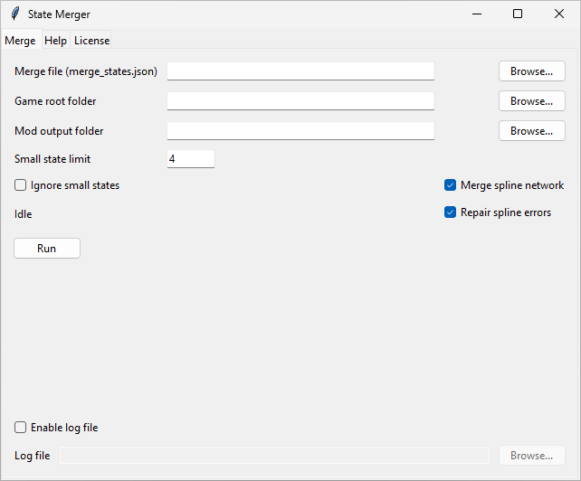
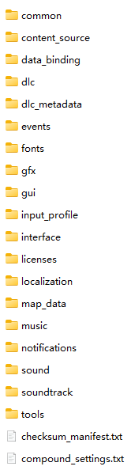
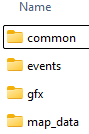

# 维多利亚3省份合并工具&教程


[](https://app.codacy.com/gh/ShabbyGayBar/StateMerger/dashboard?utm_source=gh&utm_medium=referral&utm_content=&utm_campaign=Badge_grade)

作者的[省份合并 mod](https://github.com/ShabbyGayBar/StateMerging) 已经发布在 [Steam 创意工坊](https://steamcommunity.com/sharedfiles/filedetails/?id=3371693463)！

## 简介

本项目包含若干 Python 脚本，用于自动化合并维多利亚3中的省份。

脚本可以自动生成以下维多利亚3的 mod 文件：
- `/common/...`
- `/event/...`
- `/gfx/...`
- `/localization/...`
- `/map_data/state_regions/...`

## 省份合并教程

### 0. 准备工作

- **二选一：**
  - 从[发布页面](https://github.com/ShabbyGayBar/StateMerger/releases)下载最新的 GUI 可执行文件。（推荐但仅 Windows）
  - **或：**
  - 安装 [Python 3.14 或更高版本](https://www.python.org/downloads/)。
  - 在命令行中运行
    `pip install "https://github.com/ShabbyGayBar/StateMerger/releases/download/v2.2.0/vic3_state_merger-2.2.0-py3-none-any.whl"`
    以通过 pip 安装本包。
- **二选一：**
  - **安装维多利亚3原版游戏（例如通过 Steam），** 如果你想从头制作 mod。
  - **或：**
  - **安装一个维多利亚3 mod（例如通过 Steam），** 如果你想在该 mod 上合并省份。

### 1. 编写省份合并规则

省份合并规则保存在 `merge_state.json` 文件中。您可以编辑此文件以自定义省份合并规则。

`merge_state.json` 文件结构类似下面这样：
```json
{
    "state_0": ["state_1", "state_2", "state_3"]
}
```

冒号左边的是省份 ID 的字符串，右边的是表示省份 ID 的字符串列表。列表中的所有省份将被合并到冒号左边的省份中。

例如，上面的 JSON 文件会将 `state_1`、`state_2` 和 `state_3` 合并到 `state_0` 中：

### 2. 运行脚本

#### 如果下载了 EXE（仅 Windows）

- 双击运行 `state-merger.exe`。
- 下图的 GUI 会冒出。

  

- 填写：
  - *Merge file (merge_states.json)*：上一步编辑的文件。
  - *Game root folder*：维多利亚3安装目录或作为基础的 mod 根目录。
    **注意！** 游戏根目录应该是维多利亚3安装目录或 mod 目录**下**的 `game` 文件夹。也就是说，你应该**在该目录中**看到以下内容：

    

  - *Mod output folder*：生成的 mod 文件保存位置。
  - *Small state limit*（可选）：省份数量小于等于该值的州将视为“小省份”，默认为 4。
  - *Log file*（可选）：如果勾选，运行时会指定位置日志文件。
- 勾选或取消：
  - *Ignore small states*（可选）：开启后合并时不会给小省份提供 buff。
  - *Enable log file*（可选）：开启后运行时会在指定位置生成日志文件。**遇到 BUG 请务必开启并提交 BUG 报告。**
  - *Merge spline network*（可选）：开启后脚本会自动生成合并后的道路网络，省去手动操作。默认开启。
  - *Repair spline errors*（可选）：开启后脚本会尝试给你一个更不容易出错的道路网络（否则将更忠于原版）。默认开启。
- 点击“运行”开始合并。
- 脚本执行大概需要 1 分钟。
- 完成后，你应该在 Mod 输出文件夹中看到如下目录结构：

  

- 你仍需要创建 `.metadata` 文件夹以使游戏识别你的 mod，也可以自行添加其他 mod 内容。更多信息请参考 [维多利亚3 Wiki](https://vic3.paradoxwikis.com/Modding)。

#### 如果使用命令行（CLI）

只需运行一行命令：

```
state-merger-cli <merge_file> <game_root> <mod_dir> [--data-dir <path>] [--small-state-limit <int>] [--ignore-small-states] [--log-level INFO] [--log-file <path>] [--stages <stage1,stage2,...>]
```

示例：

```
state-merger-cli merge_states.json "C:/Program Files (x86)/Steam/steamapps/common/Victoria 3/game" "C:/path/to/mod"
```

你也可以输入 `state-merger-cli --help` 查看所有可用选项。

## 反馈

### Bug 反馈

如果您遇到任何问题，都请在 Issues 中提出，并附上日志文件。

## 声明

- 本 Python 脚本使用 [Pyradox](https://github.com/ajul/pyradox) 进行 Paradox 游戏文件解析。
- 维多利亚3游戏及其数据文件归 Paradox Interactive 所有。
- 本项目是非官方的 modding 工具，与 Paradox Interactive 无关。

# 开源许可

除 [THIRD_PARTY_NOTICES.md](../THIRD_PARTY_NOTICES.md) 中列明的第三方文件外，本仓库中的原创源代码、文档、数据和图稿均采用 [GNU 通用公共许可证第 3 版或后续版本](../LICENSE)，其中包括 `docs/images/icon.png` 和 `merge_states.json`。

GPL 不适用于 `src/vic3_state_merger/assets/flag_definitions_usa.py`，该文件改编自《维多利亚3》。生成文件中包含的 StateMerger 原创内置模板仍受 GPL 约束；但使用本工具处理用户提供的游戏数据，并不会自动使这些输入数据适用 GPL。有关材料来源、权利归属和适用条款，请参阅 [THIRD_PARTY_NOTICES.md](../THIRD_PARTY_NOTICES.md)。
